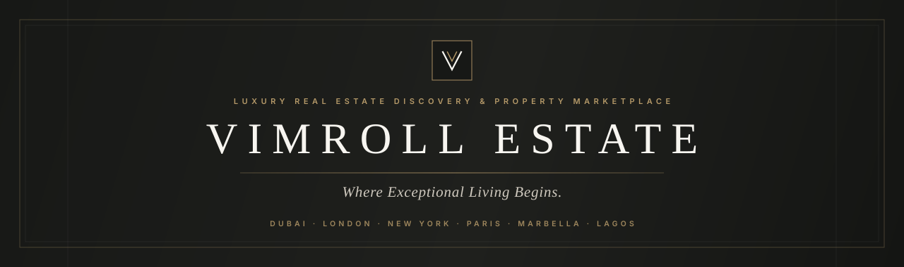
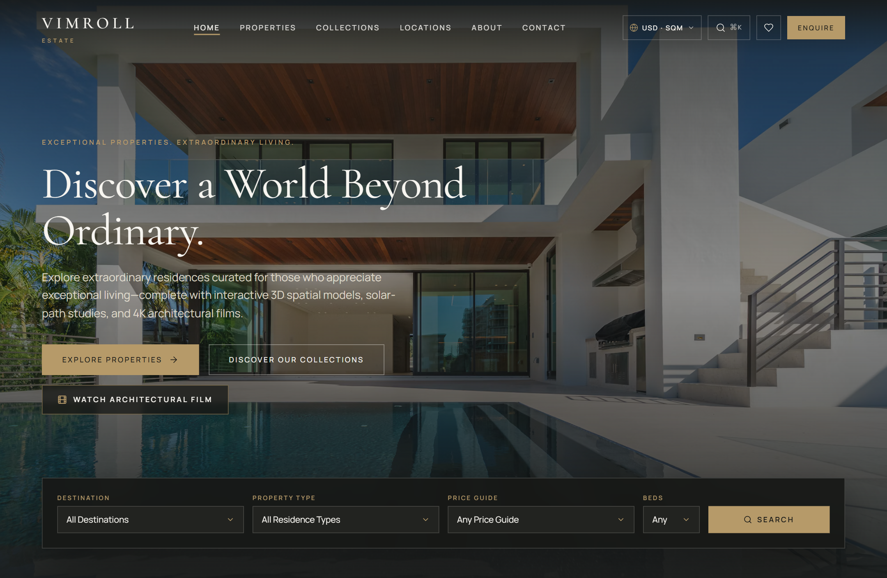
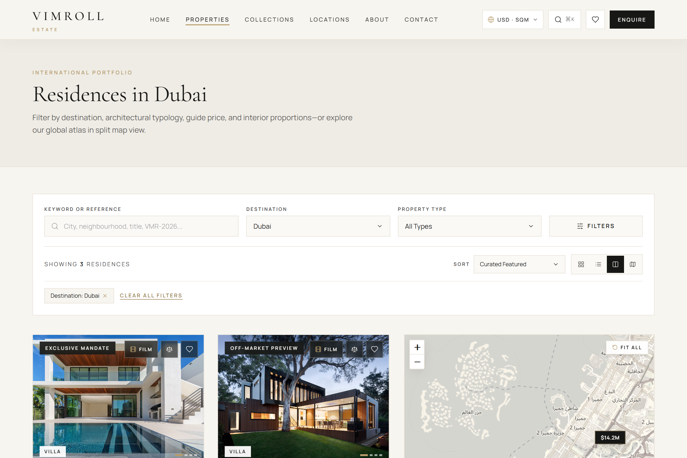
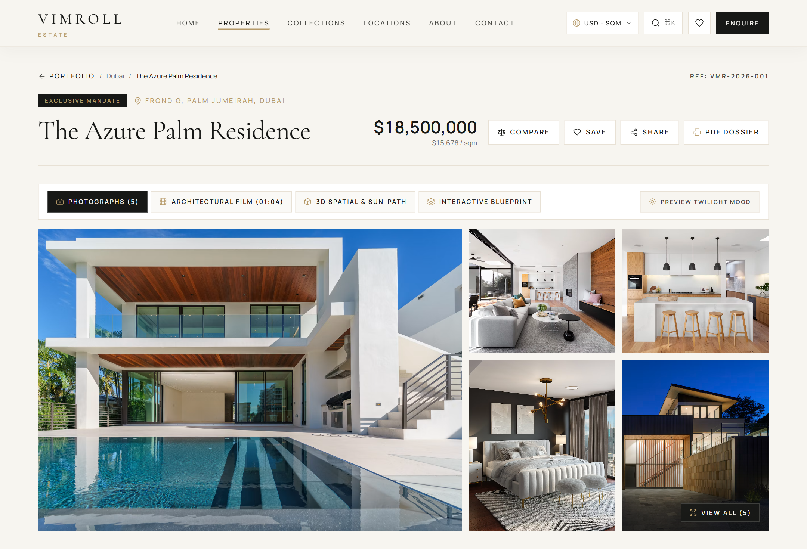
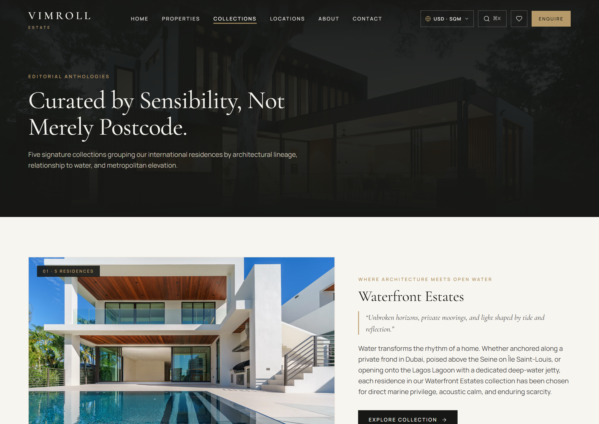
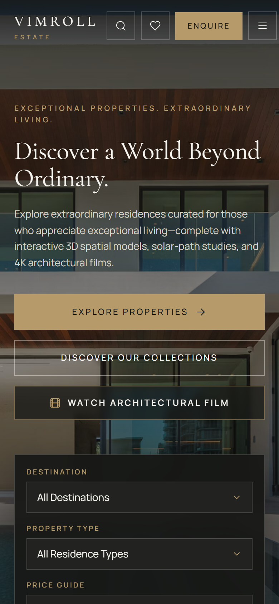
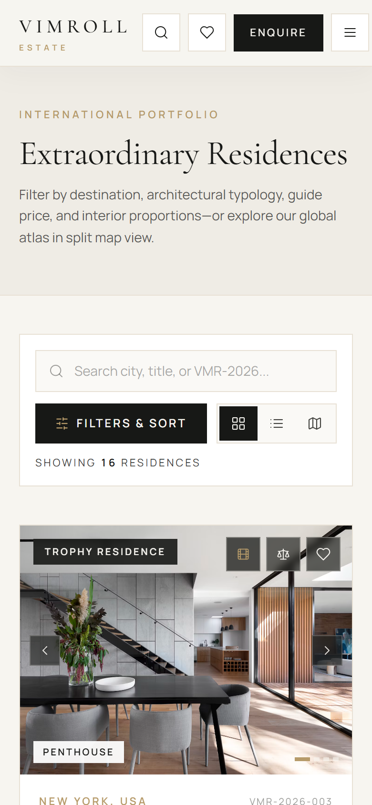
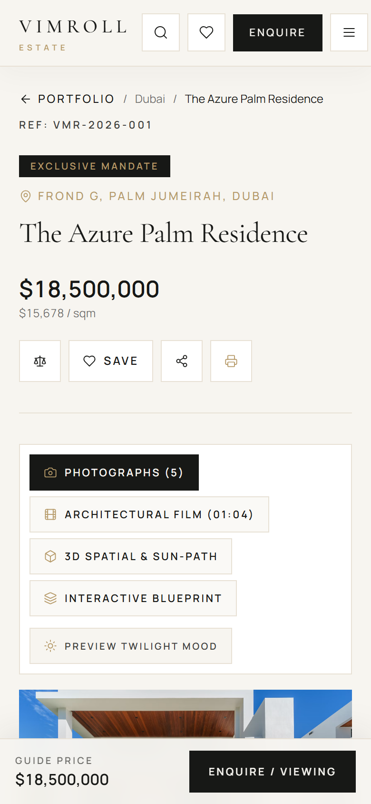

<div align="center">
  

  <br />
  <br />

  <p>
    <a href="https://vimroll-estate.vercel.app">
      
    </a>
    
    
    
    
    
    
  </p>

  <p>
    <strong>Where Exceptional Living Begins.</strong><br />
    A flagship luxury real estate discovery platform, 3D spatial exploration suite, and international property marketplace spanning <strong>Dubai, London, New York, Paris, Marbella, and Lagos</strong>.<br />
    <a href="https://vimroll-estate.vercel.app"><strong>Explore Live Deployment → vimroll-estate.vercel.app</strong></a>
  </p>
</div>

---

## Visual Showcase

### Flagship Homepage, Ambient Architectural Film & Live Search


### Property Discovery — Split List & Interactive Price-Pin Atlas


<table>
  <tr>
    <td width="50%">
      <strong>Residence Dossier &amp; 4-Mode Spatial Media Suite</strong><br /><br />
      
    </td>
    <td width="50%">
      <strong>Curated Editorial Collections</strong><br /><br />
      
    </td>
  </tr>
</table>

### Mobile-First Responsive Experience (`375px` – `390px`)

<table>
  <tr>
    <td width="33%" align="center">
      <strong>Mobile Hero &amp; Search</strong><br /><br />
      
    </td>
    <td width="33%" align="center">
      <strong>Mobile Discovery &amp; Filter Drawer</strong><br /><br />
      
    </td>
    <td width="33%" align="center">
      <strong>Mobile Dossier &amp; Sticky Enquiry Bar</strong><br /><br />
      
    </td>
  </tr>
</table>

---

## 3D Spatial Architecture, Video Walkthroughs & UHNW Intelligence

- **Unified 4-Mode Residence Media Suite (`/properties/:slug`)**:
  1. **Photographs + Daylight / Twilight Atmospheric Grading**: Switch any residence gallery between crisp daytime light and warm dusk illumination grading.
  2. **4K Choreographed Architectural Film (`01:04`)**: Interactive 4-chapter cinematic walkthrough (*01 · Architectural Arrival & Facade*, *02 · Principal Reception & Living Volume*, *03 · Primary Suite & Private Atelier*, *04 · Terrace Horizon & Dusk Illumination*) with scrubbable `#B69A69` timeline, `1.0x`/`0.75x` slow-motion toggle, fullscreen mode, and optional Web Audio ambient soundscape. Also available as an inline preview inside every `PropertyCard`.
  3. **Interactive 3D Architectural Maquette & Live Solar-Path Stage (`Three.js WebGL`)**: Orbitable 3D massing model tailored to each residence's typology (*Sky Penthouse*, *Georgian/Haussmann Townhouse*, *Cantilevered Waterfront Villa*) with **Explode Floors (`L0`–`L3`)**, 4 camera presets (*Aerial 3/4*, *Facade*, *Pool & Loggia*, *Plan View*), and a **Live Solar-Path Scrubber (`06:00` – `22:00`)** casting real-time sun trajectories and warm interior/pool glow at night.
  4. **Interactive Multi-Level CAD Blueprint Explorer**: Vector architectural floorplates across 3 levels with clickable room zones, live `sqm`/`sq ft` unit conversion, ceiling heights, and solar aspect notes.
- **Interactive 3D Global Enclave Globe & Private Aviation Network (`/locations`)**: Orbitable dark-obsidian Three.js globe plotting VIMROLL's 6 global capitals (**Dubai, London, New York, Paris, Marbella, Lagos**) with elevated 3D great-circle private-jet flight corridors (*Gulfstream G700* / *Bombardier Global 7500* flight durations and nautical miles).
- **UHNW Logistics, Aviation & Technical Intelligence Dossier**: Dedicated executive brief on every residence detailing nearest private jet FBO transfer time, heliport/yacht berth capability, acoustic glazing rating (`dB`), security protocol tier, and one-click **PDF Dossier Print**.

---

## Curated Global Portfolio

Every residence in the **VIMROLL Estate** anthology carries a unique `VMR-2026-XXX` reference, architectural narrative, verified coordinates, and assigned Private Client Advisor:

<table>
  <tr>
    <td width="33%" align="center">
      
      <br />
      <sub><strong>The Azure Palm Residence</strong> · Palm Jumeirah, Dubai · <code>$18,500,000</code></sub>
    </td>
    <td width="33%" align="center">
      
      <br />
      <sub><strong>No. 14 Eaton Terrace</strong> · Belgravia, London · <code>$29,500,000</code></sub>
    </td>
    <td width="33%" align="center">
      
      <br />
      <sub><strong>The Park Loggia Triplex</strong> · Billionaires' Row, NYC · <code>$36,000,000</code></sub>
    </td>
  </tr>
  <tr>
    <td width="33%" align="center">
      
      <br />
      <sub><strong>L'Appartement Montaigne</strong> · Triangle d'Or, Paris · <code>$16,750,000</code></sub>
    </td>
    <td width="33%" align="center">
      
      <br />
      <sub><strong>Villa Horizonte</strong> · La Zagaleta, Marbella · <code>$15,900,000</code></sub>
    </td>
    <td width="33%" align="center">
      
      <br />
      <sub><strong>The Lagoon Pier Residence</strong> · Banana Island, Lagos · <code>$7,800,000</code></sub>
    </td>
  </tr>
</table>

---

## Signature UX & International Buyer Capabilities

- **Global Multi-Currency & Measurement Switcher**: Live conversion across `USD ($)`, `GBP (£)`, `EUR (€)`, `AED`, and `NGN (₦)` plus instant `sqm` ↔ `sq ft` unit toggling across every card, map pin, 3D stage, floorplan, dossier, calculator, and comparison matrix.
- **`⌘K` / `Ctrl+K` Spotlight Search**: Instant global search modal across residences, `VMR-2026-XXX` reference codes, international destinations, and architectural collections.
- **Bespoke Accessible Controls (`LuxurySelect`)**: Custom keyboard-navigable (`ArrowUp`, `ArrowDown`, `Enter`, `Escape`, `role="listbox"`) dropdowns with zero raw OS `<select>` menus.
- **Inline Card Photo Scrubber, Inline Film Preview & 3D Tilt**: Cycle through residence photography or launch an inline architectural film preview directly inside listing cards, paired with subtle 3D perspective card tilt and bidirectional map pin highlighting.
- **Private Wealth Financing Estimator**: Interactive equity contribution, amortisation horizon, and private bank rate sliders calculating monthly servicing in the buyer's chosen currency.
- **Mobile-First Ergonomics**: `100svh` hero sizing, `44px` touch targets, slide-up mobile filter & sort bottom-sheet drawer on `/properties`, sticky mobile bottom enquiry bar on `/properties/:slug`, and horizontal-scroll comparison hints.

---

## Brand & Design Direction

| Swatch | Token | Hex | Usage |
| :---: | :--- | :--- | :--- |
|  | **Midnight Charcoal** | `#171816` | Hero overlays, 3D stages, dark editorial bands, CTA, footer |
|  | **Warm Ivory** | `#F7F5F0` | Primary background canvas |
|  | **Champagne Gold** | `#B69A69` | Restrained hairline accents, 3D beacons, eyebrows, active states |
|  | **Soft Beige** | `#E8E1D5` | Secondary surfaces, hairline borders, filter chips |
|  | **Deep Grey** | `#41413D` | Editorial body copy |
|  | **Crisp White** | `#FFFFFF` | Cards, sticky consultant panels, modals |

- **Typography**: `Cormorant Garamond` for editorial display headings paired with `Manrope` (`tabular-nums`) for navigation, controls, floor areas, and pricing.

---

## Technology Stack

| Layer | Technology |
| :--- | :--- |
| UI Development | React 18 (JavaScript / JSX) |
| Build Tooling | Vite 6 |
| Styling | Tailwind CSS v4 (`@tailwindcss/vite`) |
| 3D Spatial & WebGL | Three.js (code-split lazy vendor chunk for 3D Maquette & Global Enclave Globe) |
| Routing | React Router v6 |
| Animations | Motion (`motion/react`) + GSAP & ScrollTrigger (`prefers-reduced-motion` safe) |
| Global Client State | Zustand (`persist` middleware) |
| Data / Server State | TanStack Query v5 |
| Form Handling & Validation | React Hook Form + Zod |
| Interactive Maps | Leaflet + React Leaflet (warm monochrome OpenStreetMap atlas — zero API key required) |
| Telemetry & Analytics | Vercel Web Analytics (`@vercel/analytics`) + Vercel Speed Insights |
| Page Metadata | React Helmet Async |
| Icons | Lucide React |

---

## Local Development

```bash
# Install dependencies
npm install

# Start Vite development server
npm run dev

# Build production bundle
npm run build

# Preview production bundle locally
npm run preview
```
